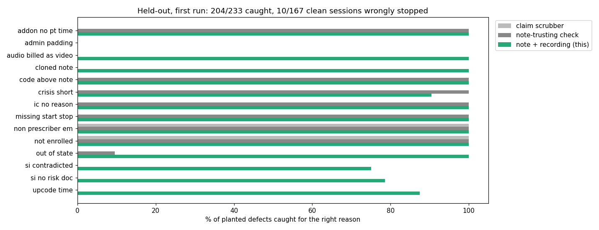

# Session claim check: the note, the claim, and what the recording shows

> Unofficial prototype by Kushagra Pratap Singh. Not affiliated with Allia Health.
> All sessions, patients, clinicians and payer profiles are synthetic. Payer rules here are illustrative, not any real payer's contract.

## The problem
Allia's EHR "transcribes visits with consent and drafts structured notes for clinician review" and runs billing in the same system ([allia.health](https://allia.health/)). As a medical group it bills for 600+ clinicians in 32 states plus telehealth ([YC](https://www.ycombinator.com/companies/allia-health)).

A claim can agree with its note and still not match the session:
- **The time band doesn't hold.** The note says 2:00–2:55 and the claim is 90837 (53+ min). But the last 6 minutes were scheduling and copay talk, which [doesn't count](https://crowncounseling.com/codes/90837-psychotherapy-60-minutes). The clinical time was 47 minutes, so the code is 90834.
- **The modality is wrong.** The note template says "video", but video dropped at minute 7 and the session went on by phone. That needs the audio-only modifier, or a hold if the payer doesn't cover audio-only.
- **The location is out of state.** The patient joined from a state where the clinician isn't licensed.
- **The risk note contradicts the patient.** The drafted note says "denies SI", but at 24:24 the client said "I've been thinking about killing myself."

The scribe already has the recording. So the check can use what happened, not just what the note says.

## What I built
`claimcheck/` (stdlib) returns **SUBMIT / FIX / HOLD / BLOCK** for each session. Every finding comes with its evidence, a concrete fix and the rule it relies on.

| Rule | What it checks |
|---|---|
| TIME_CODE | billed psychotherapy code vs minutes documented in the note (90832 16–37, 90834 38–52, 90837 53+; add-ons the same) |
| TIME_EVIDENCE | billed band vs **clinical minutes in the recording**, with scheduling, payment and goodbye talk at the ends trimmed; suggests the supported code |
| START_STOP | payer profile requires actual start/stop clock times |
| ADDON_EM / CREDENTIAL | 90833/6/8 need an E/M and psychotherapy minutes documented separately; E/M only by prescribers |
| MODALITY | platform log: video share of clinical time → POS 10/02/11 + 95 / 93 / not covered, per payer profile |
| LICENSE_STATE | patient's check-in location at session time vs clinician licenses |
| ENROLLMENT | clinician enrolled with the payer |
| IC_90785 / CRISIS | 90785 pairing + documented reason; 90839 ≥ 30 min, 90840 per extra 30, not with 90832–8 |
| RISK_DOC | client SI statements in the transcript (negated, past, third-person and question echoes filtered) vs the note: missing → FIX, "denies" → HOLD for the clinician |
| CLONED | > 80% 5-gram overlap with the previous visit's note |

The note parser reads a wide range of time and duration wording:
- "2:03 PM - 2:55 PM", "14:03", "1403-1455", "2.03 p.m.", "Time in/Time out";
- durations written as numbers or words ("fifty-two minutes");
- psychotherapy time stated separately from E/M time;
- SOAP/BIRP/DAP notes, and one-paragraph notes.

The two baselines get the same rules but less evidence:
- **claim scrubber:** the claim and the clinician/payer registry only;
- **note-trusting check:** every rule, but time, modality and location are read from the note and there is no recording.

## Results: held-out, first run
400 generated sessions, 233 of them with exactly one planted defect (14 kinds). The other 167 are clean but include look-alikes:
- negated, past and third-person SI;
- SI that the note documents correctly;
- brief video dropouts;
- scheduling talk that the note correctly excludes.

The held-out phrase bank was frozen in git before the first run (`heldout/bank_heldout.json`, commit bda4f67). It has new time formats, note templates, SI lines, scheduling talk, and risk and 90785 wording. The checker had never run on any of it. Raw output: `out/heldout_first_run.json`.

| | Defects caught for the right reason | Clean sessions wrongly stopped |
|---|---|---|
| claim scrubber | 40 / 233 | 0 / 167 |
| note-trusting check | 123 / 233 | 21 / 167 |
| **note + recording + platform log (this), first run** | **204 / 233** | **10 / 167** |
| this, after the disclosed fix below | 233 / 233 | 0 / 167 |



**What the first run got wrong. All of it was vocabulary:**
- **Scheduling talk worded differently.** "Do you want to keep Tuesdays at four?", "reminder text" and "the statement is in your inbox" weren't recognised. So that talk counted as clinical time, and all 20 time-padding cases got through, plus 2 upcodes and 2 short crisis claims.
- **A negation that isn't one.** "I don't see the point of living anymore." was read as negated, so 5 SI cases were missed.
- **A 90785 reason worded differently.** "mother attended and her emotional reactions interfered" wasn't recognised, so 10 clean sessions were wrongly stopped.

One fix after the run (commit 644f94b) added weekday/reminder/statement words, the "don't see the point" phrase, and mother/father/interfered. The first version of that fix also added "family member". That hid 5 real missing-reason cases on dev, so I removed it. **The after-fix row is no longer held-out**, because I had seen those phrases. The first-run row is the honest number for wording it hasn't met before.

**Limits**
- Synthetic sessions, with templated notes and transcripts. Real notes and recordings are messier: speaker diarisation errors, crosstalk, notes edited by the clinician.
- **Payer rules are illustrative profiles.** Real modifier and POS rules vary by payer and change often.
- The SI and scheduling vocabularies are lexicons. The held-out run shows how they fail on new wording. In production, I'd pair them with a model and keep a labelled set of real phrasings.
- Clinical time is measured from the transcript's edges only. Scheduling talk in the middle of a session still counts.

## Run it
```
python demo.py                  # 3 sessions: time padding, "denies SI" vs the recording, audio billed as video
python evaluate.py heldout      # the table above
python -m unittest discover tests
```
Python 3.10+, no dependencies (matplotlib only for `docs/plot.py`).
